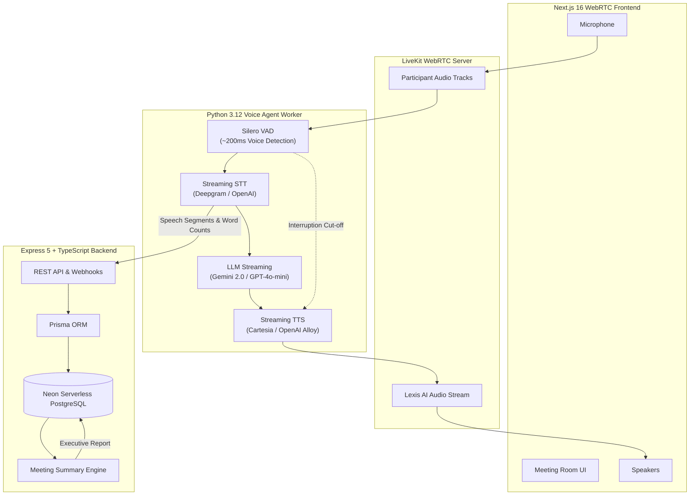

# 🎙️ Lexis — AI-Powered Real-Time Group Meeting Platform

> **An intelligent group calling platform with zero-diarization speaker attribution, real-time voice AI participation, live meeting analytics, and automated post-meeting intelligence documentation.**

---

[](https://nodejs.org/)
[](https://www.python.org/)
[-black.svg)](https://nextjs.org/)
[](https://livekit.io/)
[-blue.svg)](https://neon.tech/)
[](https://www.prisma.io/)

---

## 📖 Essential Documentation

| Document | Description |
| :--- | :--- |
| 📋 **[nextsteps.md](./nextsteps.md)** | **Start Here!** Sequential step-by-step checklist of remaining tasks. |
| 📘 **[ARCHITECTURE.md](./ARCHITECTURE.md)** | Deep architectural blueprint, data flows, and technical decisions. |
| 💡 **[free.md](./free.md)** | Guide to running this platform **100% free** using official provider credits. |

---

## ✨ Key Features

- **⚡ Zero-Diarization Individual Speaker Attribution**: By leveraging LiveKit WebRTC's individual participant audio tracks, Lexis identifies speakers directly from their connection tokens with 100% precision—no complex or buggy ML diarization models needed.
- **🤖 Autonomous Voice AI Participant**: An AI agent ("Lexis AI") joins the call as a real peer. It listens via Silero VAD, transcribes via Deepgram/Whisper, reasons with Gemini/GPT-4o, and streams natural voice replies with sub-second latency.
- **🛑 Real-Time Barge-in & Interruption**: If a human interrupts the AI while it's speaking, Silero VAD immediately cuts off the AI audio track and returns the floor to the human.
- **📊 Real-Time Per-Participant Analytics**: Tracks individual speaking duration (seconds), word counts, and questions asked for every human in the room.
- **📝 Automated Meeting Intelligence**: When a call wraps up, an LLM analyzes the full transcript to generate:
  - Executive Overview
  - Key Decisions Made
  - Action Items Table (with assignees & deadlines)
  - Individual Contribution Summaries

---

## 🏗️ System Architecture



---

## 🛠️ Tech Stack

| Layer | Technologies Used |
| :--- | :--- |
| **Frontend** | Next.js 16 (App Router), React 19, TypeScript, Tailwind CSS v4, `@livekit/components-react`, `@react-oauth/google`, Lucide Icons |
| **Backend API** | Node.js, Express 5, TypeScript, Prisma ORM 6, JWT, bcryptjs, `google-auth-library` |
| **Database** | PostgreSQL (Neon Serverless Postgres) |
| **Real-Time Media** | LiveKit SFU (WebRTC Audio & Video) |
| **Voice AI Agent** | Python 3.12, `livekit-agents` v1.8+, Silero VAD, `aiohttp` |
| **AI Providers** | Google Gemini 2.0 Flash (Free LLM), Deepgram Nova-2 (STT), OpenAI GPT-4o-mini / Whisper, Cartesia Sonic (TTS) |

---

## 📂 Repository Structure

```text
Lexis/
├── backend/                  # Express + TypeScript REST API
│   ├── controller/           # auth, room, call controllers
│   ├── middlewares/          # auth & service token middleware
│   ├── routes/               # Express route declarations
│   ├── services/             # ai.service.ts (Gemini & OpenAI summarizer)
│   ├── prisma/               # schema.prisma & PostgreSQL migrations
│   ├── server.ts             # Server entry point
│   └── package.json
│
├── agent/                    # Python LiveKit Voice AI Worker
│   ├── agent.py              # Main VAD + STT + LLM + TTS pipeline
│   ├── requirements.txt      # Python dependencies
│   ├── .env.example          # Agent configuration template
│   └── venv/                 # Virtual environment
│
├── frontend/                 # Next.js 16 Web Application
│   ├── app/                  # Next.js App Router (login, dashboard, room)
│   ├── package.json
│   └── tailwind.config.ts
│
├── free.md                   # Complete guide to 100% free credits
├── nextsteps.md              # Action checklist for next development steps
├── ARCHITECTURE.md           # Master blueprint & technical spec
└── Readme.md                 # This file
```

---

## 🚀 Getting Started

### 1. Prerequisites
- **Node.js**: v20 or higher (`node -v`)
- **Python**: v3.12 or higher (`python3 --version`)
- **PostgreSQL**: Neon database URL (already configured in `backend/.env`)

---

### 2. Backend Setup
```bash
cd backend
npm install
npx prisma generate
npm run dev
```
*API will run at `http://localhost:5000` (Health check at `http://localhost:5000/health`).*

---

### 3. Voice AI Agent Setup
```bash
cd agent
source venv/bin/activate
pip install -r requirements.txt
python agent.py download-files    # Pre-downloads Silero VAD weights
python agent.py dev               # Runs the worker in development mode
```

---

### 4. Frontend Setup
```bash
cd frontend
npm install
npm run dev
```
*App will run at `http://localhost:3000`.*

---

## 📡 API Reference Overview

### 🔐 Authentication (`/api/auth`)
| Method | Endpoint | Description |
| :--- | :--- | :--- |
| `POST` | `/api/auth/register` | Register new user with email & password |
| `POST` | `/api/auth/login` | Login with credentials |
| `POST` | `/api/auth/google` | Sign in or sign up with Google ID Token |
| `POST` | `/api/auth/forgot-password`| Request 15-minute password reset token |
| `POST` | `/api/auth/reset-password` | Set new password using reset token |
| `GET`  | `/api/auth/me` | Fetch authenticated user profile |

### 🏠 Rooms (`/api/rooms`)
| Method | Endpoint | Description |
| :--- | :--- | :--- |
| `POST` | `/api/rooms` | Create a room (returns code e.g. `lex-449-c8dc`) |
| `POST` | `/api/rooms/join` | Join room via 8-character code |
| `GET`  | `/api/rooms/my` | Get all rooms created or joined by user |
| `GET`  | `/api/rooms/:identifier`| Get room details and active call |
| `POST` | `/api/rooms/token` | Generate LiveKit WebRTC Access Token |

### 📞 Calls & Meeting Intelligence (`/api/calls`)
| Method | Endpoint | Description |
| :--- | :--- | :--- |
| `POST` | `/api/calls/start` | Start or retrieve active call in room |
| `PUT`  | `/api/calls/:id/end` | End call and calculate duration |
| `POST` | `/api/calls/transcript/segment` | Save speech chunk, auto-update speaking time & words |
| `GET`  | `/api/calls/:callId/transcript` | Get full transcript with segments |
| `POST` | `/api/calls/:id/generate-summary` | **Trigger AI to generate meeting report** |

---

## 📜 License
ISC © 2026 Lexis Team.
