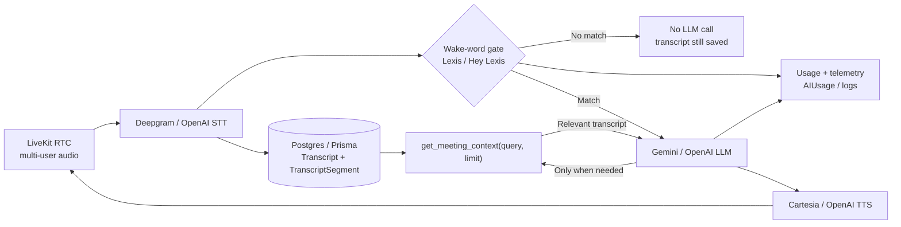

# Lexis Wake-Word Gated AI Meeting Assistant — Implementation Plan

## Goal

Convert Lexis into a group-call voice assistant where:

- STT runs continuously for the whole call.
- Every finalized transcript segment is stored with speaker attribution.
- The LLM is invoked only when someone says a wake phrase such as **Lexis** or **Hey Lexis**.
- Transcript/meeting context is fetched only when the LLM needs it, through a function tool or optional MCP tool.
- LLM calls, tokens, false triggers, and wake-word events are observable.
- The project demonstrates a production-style real-time AI architecture suitable for a resume.

## Target Architecture



## Current Gaps

1. The wake-word logic exists in `agent/agent.py:32-70` and `agent/agent.py:237-267`, but it is a soft gate over LiveKit's default turn-taking. `session.interrupt()` cannot reliably prevent an LLM request that has already started.
2. `"ai"` and `"hey ai"` are configured as wake words in `agent/agent.py:40-41`, and matching is substring-based in `agent/agent.py:67-70`. Ordinary words such as *again*, *explain*, *email*, and *said* can trigger Lexis.
3. Inside the 30-second active window, `agent/agent.py:258-261` deliberately lets all speech be handled normally, so other users can trigger responses without saying the wake word.
4. Transcript persistence is implemented in `agent/agent.py:84-118` and `backend/controller/call.controller.ts:301-392`, but the agent gets `callId` from LiveKit room metadata at `agent/agent.py:126-135`. No code in this repo currently writes that metadata, so transcript posts can be skipped at `agent/agent.py:92-93`.
5. The live LLM receives only LiveKit's in-session chat context. There is no function tool, MCP tool, or retrieval call for historical transcript context.
6. `AIUsage` is written only by the post-call summary endpoint in `backend/controller/call.controller.ts:470-556`; live LLM usage and false-trigger telemetry are not tracked.

---

## 1. Hard Wake-Word Gate

**Status:** Implemented

**Outcome:** LLM only runs on **Lexis / Hey Lexis** and close variants. All other turns are stopped before LLM generation.

### Files

- `agent/agent.py`

### Changes

- Remove generic triggers such as `"ai"` and `"hey ai"`.
- Keep only explicit Lexis-family phrases and tested STT mishearings:
  - `hey lexis`
  - `ok lexis`
  - `lexis`
  - `hey lewis`
  - `lewis`
  - `l axis`
  - `laxis`
- Replace substring matching with word-boundary matching using regex, so `lexis` does not match unrelated words.
- Disable preemptive generation:

```python
turn_handling=TurnHandlingOptions(
    preemptive_generation={"enabled": False},
)
```

- Gate before the LLM call using an `Agent` subclass:

```python
class LexisAgent(Agent):
    async def on_user_turn_completed(self, turn_ctx, new_message):
        text = new_message.text_content or ""
        if not wake_word_match(text):
            raise StopResponse()
        new_message.content = [strip_wake_word(text)]
```

- Remove the “within active window, let the session respond automatically” branch, or replace it with an explicit, short active-window state machine that still requires a trigger on the first follow-up turn.
- Keep bare wake-word acknowledgement as TTS-only, not LLM.
- Optionally use `turn_detection="manual"` for the strictest gate: commit only wake-word turns with `session.commit_user_turn()` and use `commit_user_turn(skip_reply=True)` for transcript-only turns.

### Acceptance Criteria

- Three people talking normally produces transcript rows but zero LLM calls.
- Saying “Lexis, summarize that” produces one LLM call.
- No `agent_state_changed -> thinking` event occurs for non-wake turns.
- No provider LLM request appears in logs for non-wake turns.

---

## 2. Continuous Transcript Pipeline

**Status:** Implemented

**Outcome:** All finalized STT segments are stored throughout the whole call, even when Lexis is silent.

### Files

- `agent/agent.py`
- `backend/controller/room.controller.ts`
- `backend/controller/call.controller.ts`

### Changes

- Keep posting every final `user_input_transcribed` event to `POST /api/calls/transcript/segment`.
- Fix LiveKit room metadata so the agent receives a real `callId`:
  - Set room metadata with `RoomServiceClient.updateRoomMetadata(...)` when a call starts, or when minting the token.
  - Metadata shape:

```json
{
  "callId": "call-id-here",
  "aiPrompt": "custom prompt",
  "aiEnabled": true
}
```

- Preserve speaker attribution using `event.speaker_id` resolved against `ctx.room.remote_participants`.
- Keep writing both:
  - `TranscriptSegment` rows for structured retrieval.
  - `Transcript.fullText` for summaries and export.
- Optionally publish a LiveKit data message from the agent so the frontend transcript sidebar receives live entries.

### Acceptance Criteria

- Every participant’s finalized utterance creates one `TranscriptSegment`.
- Speaker name, content, sequence, and `isAi` values are correct.
- AI responses are stored with `speakerName = "Lexis AI"` and `isAi = true`.
- Transcript rows exist even when no LLM call was made.

---

## 3. On-Demand Context Tool

**Status:** Implemented

**Outcome:** The LLM does not receive the full transcript by default. It fetches context only when needed.

### Files

- `agent/agent.py`
- `backend/routes/call.routes.ts`
- `backend/controller/call.controller.ts`

### Backend Endpoint

Add a service-token-protected endpoint:

```text
GET /api/calls/:callId/context?query=decision&limit=20
```

Behavior:

- Query `TranscriptSegment` by `transcript.callId`.
- Return the most recent `limit` segments.
- If `query` is present, prefer segments whose `content` matches the query terms.
- Return compact JSON:

```json
{
  "callId": "call-id-here",
  "segments": [
    {
      "speakerName": "Ada",
      "content": "We decided to move the launch to Friday.",
      "sequence": 42,
      "startTime": 0,
      "endTime": 0
    }
  ]
}
```

### Agent Function Tool

Add a LiveKit function tool:

```python
@function_tool()
async def get_meeting_context(
    self,
    context: RunContext,
    query: str,
    limit: int = 20,
) -> str:
    """Fetch relevant transcript context from the current meeting."""
```

- Call the backend endpoint with `x-service-token`.
- Return a compact transcript block to the LLM.
- Add a prompt rule:

```text
Use get_meeting_context only when the user asks about earlier discussion,
decisions, action items, or something that was said earlier in the call.
Do not call it for general conversation.
```

### Optional MCP Upgrade

After the function tool works, expose the same backend endpoint as an MCP tool to demonstrate MCP integration. Keep the function tool as the primary path because it is simpler and fully controlled inside the LiveKit agent.

### Acceptance Criteria

- Normal wake-word questions that need no history do not trigger the context tool.
- “Lexis, what did we decide?” triggers `get_meeting_context`.
- The LLM answer uses retrieved transcript lines.
- The prompt does not include the full transcript unless the tool is called.

---

## 4. Cost and Usage Tracking

**Status:** Implemented

**Outcome:** Prove that wake-word gating reduces LLM invocations and track AI cost per call.

### Files

- `agent/agent.py`
- `backend/controller/call.controller.ts`
- `backend/prisma/schema.prisma` if a migration is acceptable

### Changes

Track these agent events:

- `wake_word_hit`
- `llm_call_started`
- `llm_call_completed`
- `context_tool_called`
- `false_trigger_blocked`
- `ai_muted_turn`

Persist or log:

- `callId`
- event type
- timestamp
- model name
- input tokens
- output tokens
- estimated cost
- latency

Options:

1. Keep a per-call in-memory counter and flush it to the backend when the session ends.
2. Post each LLM invocation to `AIUsage` immediately.
3. Add a new `AgentEvent` table for wake-word and false-trigger telemetry while keeping `AIUsage` for token/cost metrics.

Also increment `CallParticipant.aiInteractions` for the participant who triggered the LLM, which is already present in the schema and used by analytics.

### Acceptance Criteria

- A normal 3-person conversation shows zero `llm_call_started` events.
- A wake-word question produces exactly one `llm_call_started` event.
- Token and cost values are visible in `AIUsage` or call details.
- False-trigger counts can be compared before and after the gate changes.

---

## 5. Demo Proof

**Outcome:** Have a repeatable demo that clearly shows the architecture working.

### Demo Script

1. Join one LiveKit room from three browser tabs or devices.
2. Let three people talk for 60–90 seconds without saying Lexis.
3. Show:
   - Transcript segments are being stored.
   - Lexis remains silent.
   - No LLM call logs appear.
4. Say: **“Lexis, what did we decide?”**
5. Show:
   - Wake-word hit log.
   - One LLM call.
   - `get_meeting_context` tool call.
   - Retrieved transcript segments.
   - Spoken answer from Lexis.
6. End the call and show:
   - Full transcript.
   - `AIUsage` row for the triggered turn.
   - Summary page if enabled.

### Evidence to Capture

- Screenshot of logs showing no LLM calls during normal conversation.
- Screenshot of the wake-word-gated LLM call.
- DB rows from `TranscriptSegment` and `AIUsage`.
- Short screen recording of the 3-person demo.

### Acceptance Criteria

- The demo can be repeated from a clean room.
- The timing of transcript writes and LLM calls is visible in logs.
- The difference between passive listening and activated response is obvious.

---

## 6. Architecture Documentation

**Outcome:** Make the system easy to explain in a resume, interview, or README.

### Files

- `ARCHITECTURE.md`
- `Readme.md`
- `plan.md`

### Changes

- Update the voice pipeline diagram to match the target architecture above.
- Document:
  - Why STT is always on.
  - Why transcript persistence is independent of LLM invocation.
  - Why the wake-word gate happens before the LLM call.
  - Why context is retrieved on demand through a function tool.
  - How `AIUsage` and logs prove cost control.
- Add a short “Design Decisions” section covering:
  - LiveKit over hosted meeting bots.
  - Managed STT/TTS APIs instead of custom speech models.
  - Function tool first, MCP optional.
  - Preemptive generation disabled to prevent silent token waste.

### Acceptance Criteria

- The README explains the system in under two minutes.
- The architecture diagram matches the implementation.
- A recruiter or interviewer can identify the real-time, distributed, and cost-control aspects quickly.

---

## Suggested Execution Order

1. Fix room metadata and transcript persistence.
2. Implement word-boundary wake-word matching.
3. Add the hard LLM gate and disable preemptive generation.
4. Add the backend context endpoint and agent function tool.
5. Add usage telemetry and false-trigger logging.
6. Run the 3-person demo and capture evidence.
7. Update `ARCHITECTURE.md` and `Readme.md`.

---

## Resume Bullets

- Built a multi-party LiveKit voice agent with Deepgram STT, Gemini LLM, and Cartesia TTS.
- Implemented wake-word-gated LLM invocation to prevent unnecessary model calls during group conversations.
- Designed continuous speaker-attributed transcript persistence with on-demand retrieval via function calling.
- Added LLM usage telemetry and hard turn-control to reduce false activations and cost.

Additional optional bullets once the MCP and telemetry work is complete:

- Exposed meeting transcript retrieval as an MCP-compatible tool for context-aware voice responses.
- Built an observability layer tracking wake-word hits, false triggers, token usage, and estimated cost per call.
